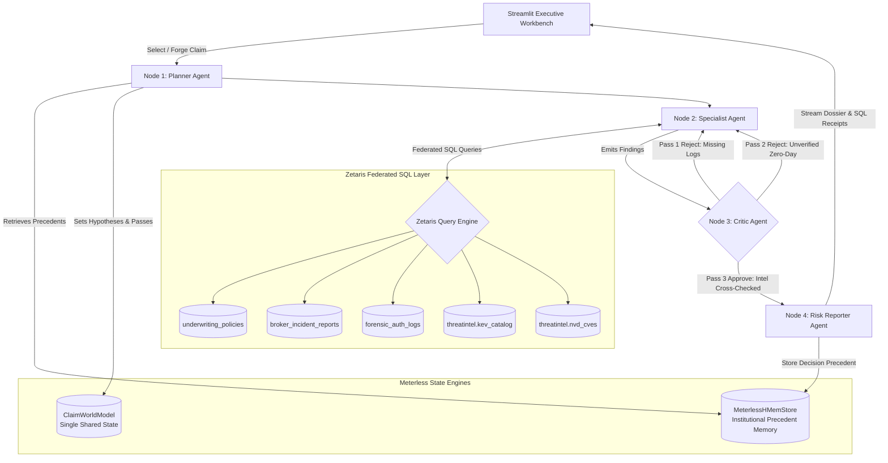

# 🛡️ HAWKEYE // Cyber Insurance Warranty & Contradiction Adjudicator

> **Open Agent Hackathon 2026 — Track 2: "The Agent That Can Explain Why"**  
> *Autonomous multi-agent claim adjudication that proves whether policyholders honored their cybersecurity warranties—or committed material misrepresentation—by federating private telemetry and public threat intelligence.*

[](https://hackos.dev)
[](https://python.org)
[](https://zetaris.com)
[](https://meterless.io)
[-76B900.svg)](https://build.nvidia.com)
[](https://streamlit.io)

---

## 📌 Executive Summary

The global cyber insurance industry pays out over **$14B annually**, but suffers from an endemic claims adjudication challenge: **warranty misrepresentation**. When a multi-million-dollar ransomware attack occurs, the insured organization and their broker typically submit a proof-of-loss claiming:
> *"We were breached by an unpreventable zero-day exploit despite enforcing 100% MFA and immutable backup locks."*

Claims adjusters are left with thousands of pages of raw Active Directory logs, firewall records, and broker assertions. Determining whether the insured honored their signed warranties has historically required weeks of manual forensic analysis.

**Hawkeye solves this.** It is an explainable multi-agent system that autonomously audits cyber claims against empirical machine telemetry and public threat intelligence. 

Instead of generating ungrounded LLM prose, Hawkeye cross-examines **3 private claim datasets** against **2 real public threat intel feeds (CISA KEV + NIST NVD)** federated through **Zetaris SQL**. Every determination produces cryptographic query receipts, step-by-step agent critique logs, and an actuarial contradiction matrix showing exactly **why** coverage was approved, flagged for reservation of rights, or escalated to fraud units.

---

## 🏗️ Architecture & How It Works

Hawkeye executes a 4-agent state machine built with **LangGraph**, **Meterless World Model**, and **Meterless H-MEM**, orchestrated with **Meterless Nightshift** routing to **NVIDIA Nemotron 30B / 120B**.



### The 4-Agent Revision Loop
1. **Planner Agent:** Formulates investigative hypotheses, inspects past claim precedents from **H-MEM** (`hmem_precedents.json`), and directs the investigation across bounded revision passes.
2. **Specialist Agent:** Drafts federated SQL queries executed over **Zetaris** (or zero-setup in-memory fallback), fetching policy attestations, machine authentication logs, and CVE records.
3. **Critic Agent (Rigorous Rule-Driven Gatekeeper):**
   - **Pass 1:** Rejects initial broker-only summaries: *"Rejected: no raw machine telemetry. Must inspect forensic_auth_logs."*
   - **Pass 2:** Inspects internal authentication logs. If the broker asserted an "unpreventable zero-day", rejects: *"Rejected: unverified zero-day assertion. Must query threatintel.kev_catalog and threatintel.nvd_cves."*
   - **Pass 3:** Cross-examines reported breach timestamps against CISA KEV catalog dates (`dateAdded`) and NIST NVD CVSS scores. Approves when all evidentiary links are established.
4. **Risk Reporter Agent:** Assigns the actuarial coverage branch, computes mathematical confidence, writes precedents back into **H-MEM**, and synthesizes an executive adjudication dossier using **NVIDIA Nemotron**.

---

## 🌟 Key Features

| Feature | Description |
|---|---|
| **Federated SQL Layer (Zetaris)** | Runs cross-database joins linking private claim tables (`claimfile.*`) with live public vulnerability feeds (`threatintel.*`). |
| **Meterless World Model** | Shared, collision-free single state across all 4 agents (`ClaimWorldModel`) preventing update loss during multi-pass reasoning. |
| **Meterless H-MEM (Precedents)** | Persistent cross-claim institutional memory (`hmem_precedents.json`). Precedents saved on earlier claims inform future planner strategies. |
| **NVIDIA Nemotron via Nightshift** | Enterprise LLM inference executed locally via Meterless Nightshift proxy (Port 8088) with bounded timeouts and retries. |
| **Live Sequential Trace Streaming** | Streamlit UI streams each agent's thoughts, SQL queries, rejections, and approvals sequentially with realistic cadence. |
| **Adversarial Claim Forge** | Interactive scenario builder allowing judges to synthesize custom attack/defense scenarios with 1-click presets. |
| **Cryptographic SQL Receipts** | Every evidentiary table item is accompanied by its Zetaris Request UUID, source identifier, row count, and millisecond latency. |

---

## ⚖️ Ground Truth Benchmark Scenarios

Hawkeye includes three built-in benchmark claims representing real-world cyber claims patterns:

| Claim ID | Insured & Amount | Broker Assertion | Telemetry Finding | Public Threat Intel (CISA / NIST) | Final Adjudication |
|---|---|---|---|---|---|
| **`CLM-2026-101`** | **Apex Regional Hospital**<br>($1,400,000) | "Unpreventable zero-day exploit" on Ivanti Connect Secure (`CVE-2023-46805`). | `LOG-99410`: `svc_backup_admin` logged in with **password only** (MFA bypassed via legacy exception); backup locks disabled by admin 18h prior. | Flaw added to CISA KEV on **Jan 10, 2024** with known ransomware use; published in NVD **2.8 years** prior to breach. **Not a zero-day.** | 🔴 **RESERVATION OF RIGHTS**<br>(Payout Withheld, ~97% Conf.) |
| **`CLM-2026-102`** | **Nexus Global Logistics**<br>($850,000) | Post-authentication browser WebP exploit (`CVE-2023-4863`). | `LOG-88201`: User passed Okta Push MFA challenge; S3 `OBJECT_LOCK_ACTIVE` blocked ransomware encryption. | Verified genuine Chromium zero-day (CVSS 8.8). Broker never claimed false zero-day. | 🟢 **STANDARD APPROVAL**<br>(Payout Approved, ~94% Conf.) |
| **`CLM-2026-103`** | **Vanguard Retail Group**<br>($2.1M) | "Unknown perimeter intrusion"; security logs lost to "routine storage rotation". | `LOG-77105`: Windows Security EventID 1102 (*"Audit log was cleared by Administrator"*), creating deliberate 6-hour blackout. | No CVE cited; LEFT JOIN against KEV/NVD returns NULL. | 🟡 **SIU TAMPERING ESCALATION**<br>(Fraud Investigation Hold) |

---

## ⚡ Quick Start & Setup Guide

Hawkeye is engineered to run seamlessly in **both live production mode** (with local Zetaris Docker & Meterless Nightshift) and **zero-setup offline demo mode** (using built-in SQLite/JSON fallbacks).

### Prerequisites
- Python **3.10** or higher
- Git
- *(Optional for live services)* Docker Desktop & Meterless Nightshift

---

### Step 1: Clone the Repository
```bash
git clone https://github.com/Shaurav-Vora/hawkeye.git
cd hawkeye
```

---

### Step 2: Set Up Virtual Environment & Dependencies
```bash
# Create and activate virtual environment
python -m venv .venv

# On Linux / macOS / WSL:
source .venv/bin/activate

# On Windows PowerShell:
.venv\Scripts\Activate.ps1

# Install core dependencies
pip install -r requirements.txt
```

---

### Step 3: Configure Environment Variables
Copy the provided `.env.example` file:
```bash
# Linux / macOS / WSL:
cp .env.example .env

# Windows PowerShell:
Copy-Item .env.example .env
```

> **Note for Judges (Zero-Setup Mode):**  
> If Zetaris Docker or Nightshift are not running locally on your evaluation machine, Hawkeye **automatically falls back to its sample data layer and built-in actuarial engine**. Everything works out of the box with zero external configuration required.

If you have Zetaris or Nightshift running locally, ensure your `.env` contains:
```env
# Zetaris Local Instance (Docker)
ZETARIS_BASE_URL=http://localhost:3000
ZETARIS_REST_URL=http://localhost:8888/api/v1.0
ZETARIS_ORG_ID=1
ZETARIS_API_KEY=your-api-key-here

# Meterless Nightshift + NVIDIA Nemotron
METERLESS_BASE_URL=http://127.0.0.1:8088/v1
METERLESS_RUNTIME_TOKEN=your-token-here
NEMOTRON_MODEL=nvidia/nemotron-3.5-lightning-30b-a3b
```

---

### Step 4: Run the Official 3-Check Smoke Test
Verify the operational health of your data and inference layers:
```bash
python smoke_test.py
```
**Expected Output:**
```text
=== HAWKEYE PRE-FLIGHT VERIFICATION ===
PASS Data: Zetaris web interface
PASS Data: Zetaris runs SQL over its REST API
PASS Power: Meterless Nightshift -> NVIDIA Nemotron
ALL SMOKE TESTS PASSED
```

---

### Step 5: Run Conformance Suite (World Model & H-MEM)
Run the 23-test validation test verifying state immutability, precedent recall, and critique loops:
```bash
python -m agent.conformance_test
```
**Expected Output:**
```text
--- METERLESS ENGINE CONFORMANCE TEST ---
PASS: seed precedent present
PASS: decision persists across instances
PASS: state mutations retained
...
PASS: CLM-101 zero-day disproven by KEV date
PASS: H-MEM learned from prior runs
PASS: Planner reads H-MEM precedents
ALL PASS (23/23 tests passed)
```

---

### Step 6: Launch the Executive Cockpit
```bash
streamlit run app.py
```
Open your browser to: **`http://localhost:8501`**

---

## 🎮 Guided Demo Walkthrough for Judges

When evaluating Hawkeye, we recommend testing the following workflow in the UI:

### 1. Adjudicate Baseline Claim `CLM-2026-101`
1. Select **`CLM-2026-101 | Apex Regional Hospital ($1,400,000)`** from the claim selector.
2. Click **`Run Investigation`**.
3. **Observe Section 2 (Live Agent Trace):** Watch the 4 agents stream sequentially:
   - Planner sets the investigation strategy.
   - Specialist queries policy & broker narrative.
   - **Critic rejects Pass 1** (`Check 1: forensic_evidence empty`).
   - Specialist queries `claimfile.forensic_auth_logs` & discovers `LOG-99410` (password-only login, legacy MFA bypass, disabled backup lock).
   - **Critic rejects Pass 2** (`Check 2: zero-day asserted, no external intel`).
   - Specialist queries live CISA KEV + NIST NVD federated join.
   - **Critic audits Pass 3 (`Audit Complete`)** and assigns `RESERVATION_OF_RIGHTS`.
   - Risk Reporter stores precedent into **H-MEM** and generates the markdown dossier.
4. **Inspect Section 3 (Contradiction Matrix):** Review the 4-column actuarial table comparing signed promises against machine proof and public records.
5. **Inspect Section 4 (SQL Receipts):** Expand the queries to verify the exact SQL, Request IDs, and millisecond latencies.

### 2. Test the Adversarial Claim Forge
1. Expand **`🔨 Adversarial Claim Forge`** at the top.
2. Click **`Preset: Ransomware Log Wiper`** or **`Preset: Zero-Day Trap`**.
3. Click **`🚀 Forge & Launch Adjudication`**.
4. Watch the engine ingest your custom scenario, query the records, and dynamically produce an explainable verdict.

---

## 📦 Dependencies & Tech Stack

Hawkeye is built on a lean, production-ready stack:

| Package | Version | Purpose |
|---|---|---|
| **`langgraph`** | `>=0.1.0` | Cyclic multi-agent graph with conditional routing and bounded loops |
| **`streamlit`** | `>=1.35.0` | Executive claims cockpit with real-time trace streaming |
| **`openai`** | `>=1.30.0` | Python client for Meterless Nightshift / NVIDIA Nemotron |
| **`pydantic`** | `>=2.7.0` | Schema validation for `ClaimWorldModel` and `ContradictionLink` |
| **`requests`** | `>=2.31.0` | REST API connectors for Zetaris SQL engine and CISA/NIST feeds |
| **`python-dotenv`**| `>=1.0.0` | Local environment configuration management |
| **`pandas`** | `>=2.0.0` | High-performance tabular data formatting for receipts |

---

## 🔒 Data Disclosure & Privacy

To protect real policyholder confidentiality and comply with hackathon rules:
- **Internal Claim Datasets (`claimfile.*`):** Underwriting policies, broker reports, and forensic server logs are **synthetic**, designed to realistically simulate corporate IT environments, Okta logs, and Windows Security Event logs.
- **External Threat Intelligence (`threatintel.*`):** All vulnerability data, CVSS scores, publication dates, and ransomware campaign affiliations are **100% real public records** sourced from the **CISA Known Exploited Vulnerabilities (KEV) Catalog** and **NIST National Vulnerability Database (NVD)**.

---

## 📂 Repository File Map

```text
hawkeye/
├── AGENTS.md                 # Living team context, architecture, task checklist & session log
├── README.md                 # Project architecture, demo script, setup guide (this file)
├── .env.example              # Environment placeholders (committed template)
├── requirements.txt          # Core Python dependencies
├── smoke_test.py             # Official 3-check pre-flight verification script
├── seed_sql.py               # Idempotent 18-statement Zetaris federated table bootstrapper
├── app.py                    # Streamlit cockpit UI with live trace streaming & Claim Forge
├── hmem_precedents.json      # Persistent H-MEM precedent memory store
├── scripts/
│   └── register_zetaris_sources.sql  # SQL DDL for Zetaris tables, containers & views
├── data/sample/              # Benchmark datasets (3 internal claims + KEV/NVD sample caches)
│   ├── underwriting_policies.json
│   ├── broker_incident_reports.json
│   ├── forensic_auth_logs.json
│   ├── cisa_kev_sample.json
│   └── nvd_cve_sample.json
└── agent/
    ├── graph.py              # Multi-agent LangGraph engine (Planner -> Specialist <-> Critic -> Reporter)
    ├── meterless_state.py    # Meterless World Model (ClaimWorldModel) + H-MEM store (MeterlessHMemStore)
    ├── tools_zetaris.py      # Zetaris REST SQL client with UUID receipts & latency logging
    ├── llm.py                # Meterless Nightshift OpenAI client routed to NVIDIA Nemotron
    ├── prompts.py            # Prompt engineering and role instructions for all 4 agents
    ├── sample_backend.py     # In-memory SQLite federated engine for zero-setup execution
    └── conformance_test.py   # Conformance test suite verifying World Model & H-MEM invariants
```

---

## 👥 Team & Submission Information

- **Hackathon:** Open Agent Hackathon 2026
- **Track:** Track 2 — *"The Agent That Can Explain Why"*
- **Sponsors Utilized:**
  - **Zetaris:** Federated SQL data layer connecting internal and external schemas.
  - **Meterless:** World Model engine + H-MEM persistent precedent memory.
  - **Meterless Nightshift:** Local inference gateway routing to NVIDIA Nemotron.
  - **NVIDIA:** Nemotron 3.5 LLM powering executive claims synthesis.
- **Repository:** [https://github.com/Shaurav-Vora/hawkeye](https://github.com/Shaurav-Vora/hawkeye)
- **License:** Apache 2.0 / MIT Open Source

---
*Built with ❤️ for the Open Agent Hackathon 2026.*
