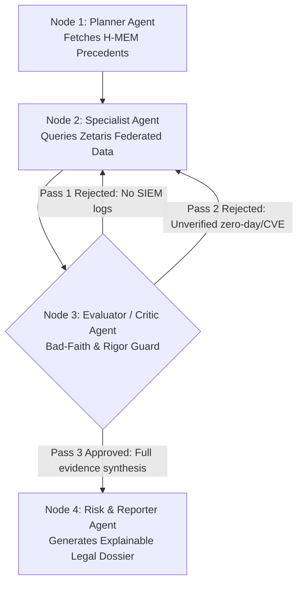

# Open Agent Hackathon 2026: Team Master Execution Guide
## Project: Cyber Insurance Warranty & Contradiction Adjudicator
**Track 2:** *The Agent That Can Explain Why*  
**Team Size:** 3 Members | **Tooling Budget:** $0 (100% Free-Tier Stack)  
**Submission Deadline:** 27 October 2026, 23:45 UTC (Hard Deadline)

---

## 1. Executive Project Blueprint

### 1.1 The Core Problem & "One Decision" Scope
When an enterprise suffers a ransomware attack and files a $1.4M cyber insurance claim, human claims adjusters spend weeks manually cross-checking underwriting forms, broker incident narratives, and raw security logs. 

Our system automates this investigation to answer **One Decision**:
> **Did the hacked company actually enforce the mandatory security controls ("Condition Precedent Warranties"—specifically 100% MFA and Immutable Offline Backups) they promised in their insurance application, or do raw forensic logs prove a material misrepresentation requiring a Reservation of Rights / Coverage Denial?**

### 1.2 The 3-Layer Sponsor Stack (Zero-Cost Configuration)
Every submission is judged on **Data**, **Build**, and **Power** layers:

| Layer | Mandatory Sponsor Tool | How We Use It (100% Free) | Owner |
| :--- | :--- | :--- | :--- |
| **01 DATA** | **Zetaris** (Local Docker or AWS Free Tier) | Unifies **5 multi-source data feeds** across 2 categories behind a single Lightning SQL REST endpoint (`http://localhost:8888/api/v1.0`):<br>1. *Internal Claim File (Synthetic, confidential in reality; served as REST from our public GitHub repo)*: `claimfile.underwriting_policies`, `claimfile.broker_incident_reports` (with `claimed_cve`), `claimfile.forensic_auth_logs`.<br>2. *External Public Threat Intel (Real, keyless, public, fetched LIVE when queried)*: `threatintel.kev_catalog` (CISA's Known Exploited Vulnerabilities) and `threatintel.nvd_cves` (NIST NVD database). | **Member 1** |
| **02 BUILD** | **Meterless Engines** + Free Coding Agent (VS Code + Cline/Roo Code, Claude Code, or Cursor Free Tier) | Implements **Meterless World Model** (shared investigation state & contradiction graph across a 3-pass critique loop) and **Meterless H-MEM** (persistent precedent memory across claims) inside a multi-agent loop. | **Member 2** |
| **03 POWER** | **Meterless Nightshift** + **NVIDIA Nemotron** (Free Endpoints) | Runs **Meterless Nightshift** locally (`http://127.0.0.1:8088/v1`) connected to free **NVIDIA API (`build.nvidia.com`)** endpoints (`nvidia/nemotron-3.5-lightning-30b-a3b` & `nvidia/nemotron-3.5-super-vl-120b-a12b`). | **Member 3** |

---

## 2. Shared Repository & `.env` Architecture

Before splitting into individual tasks, initialize a shared GitHub repository with this exact structure:

```text
open-agent-hack/
├── AGENTS.md                 # Living AI-agent context + per-member task checklist (AIs must update it)
├── .env.example              # Safe placeholder template committed to Git
├── .gitignore                # MUST include .env, .env.local, .venv/
├── README.md                 # Setup instructions, architecture & sponsor write-up
├── requirements.txt          # openai, python-dotenv, requests, langgraph, streamlit, pydantic
├── smoke_test.py             # Official 3-check verification script
├── seed_sql.py               # Automates registration of all 5 sources in Zetaris (sends scripts/register_zetaris_sources.sql); SAMPLE_MODE fallback
├── data/
│   ├── README.md             # Source URLs, licenses, and Zetaris registration steps
│   └── sample/               # Small committed offline fallback for SAMPLE_MODE=true
│       ├── underwriting_policies.json   # {"records":[...]} also served to Zetaris via raw GitHub URL
│       ├── broker_incident_reports.json
│       ├── forensic_auth_logs.json
│       ├── cisa_kev_sample.json
│       └── nvd_cve_sample.json
│   └── sql/claims_seed.sql       # OPTIONAL stretch: Postgres version of the claim file (not required)
├── scripts/
│   └── register_zetaris_sources.sql  # Zetaris registration statements (REST tables + views), run one at a time
├── agent/
│   ├── llm.py                # Power Layer: Meterless Nightshift OpenAI-compatible client
│   ├── tools_zetaris.py      # Data Layer: run_sql() wrapper calling Zetaris REST API
│   ├── meterless_state.py    # Build Layer: Meterless World Model & H-MEM integration
│   ├── graph.py              # Multi-agent orchestration (Planner <-> Specialist <-> Critic -> Risk)
│   └── prompts.py            # System prompts for the specialized agent roles
└── app.py                    # Streamlit 2-pane UI (Live 3-Pass Agent Debate Trace + Final Dossier)
```

### Master `.env.example` File
Commit this file to GitHub (never commit your real `.env`):
```ini
# --- 01 DATA: ZETARIS SETTINGS ---
ZETARIS_BASE_URL=http://localhost:3000
ZETARIS_REST_URL=http://localhost:8888/api/v1.0
ZETARIS_ORG_ID=1
ZETARIS_API_KEY=your-zetaris-api-key-here
ZETARIS_USERNAME=your-admin-email@example.com
ZETARIS_PASSWORD=YourStrongPassword1$

# --- 03 POWER: METERLESS NIGHTSHIFT & NVIDIA NEMOTRON ---
METERLESS_BASE_URL=http://127.0.0.1:8088/v1
METERLESS_RUNTIME_TOKEN=your-nightshift-console-token-here
METERLESS_MODEL=meterless/auto

# --- OFFLINE FALLBACK ---
SAMPLE_MODE=false

# --- SMOKE TEST ALIASES (Required by official smoke_test.py) ---
MODEL_BASE_URL=http://127.0.0.1:8088/v1
MODEL_API_KEY=your-nightshift-console-token-here
NEMOTRON_MODEL=nvidia/nemotron-3.5-lightning-30b-a3b
```

---

## 3. Member 1 Guide: Data & Zetaris Lead (The "Facts" Layer)

**Your Mission:** Stand up the Zetaris platform, register/seed the **5 multi-source datasets** across internal and external boundaries (3 internal synthetic claim tables + 2 real public threat intelligence sources: CISA KEV and NIST NVD), verify SQL execution over REST, execute cross-source joins, and build `agent/tools_zetaris.py` and `seed_sql.py`.

**Status legend (updated 2026-10-24):** ✅ DONE = verified working · ◐ IN PROGRESS · ⬜ TODO

### 3.1 The Multi-Source Architecture: Synthetic Internal + Real Public External
If one script produces three internal tables in a single database, it is "multi-source in name only." Track 2 requires an agent that gathers evidence across disparate sources and connects findings. To achieve top scores in **Technical (20)** and **Sponsor Tech (10)**, we combine confidential internal claim records with real-world public intelligence:

| Source (Zetaris name) | Origin | Real or Synthetic | How Zetaris Reaches It | Status |
| :--- | :--- | :--- | :--- | :--- |
| `claimfile.underwriting_policies` | Insurer's policy administration file | Synthetic (confidential in reality) | REST table over `data/sample/underwriting_policies.json` on our **public** GitHub repo (raw URL), flattened by a view | ◐ |
| `claimfile.broker_incident_reports` | Broker's claim submission | Synthetic, but cites **real CVE IDs** | Same pattern (`broker_incident_reports.json`) | ✅ verified |
| `claimfile.forensic_auth_logs` | Client's SIEM / VPN / DC export | Synthetic, using real log formats | Same pattern (`forensic_auth_logs.json`) | ◐ |
| **`threatintel.kev_catalog`** | CISA's Known Exploited Vulnerabilities Catalog (1,756 entries, catalog version 2026.10.23) | **Real, keyless, public, LIVE** | REST table over GitHub mirror of CISA's official repo (`cisagov/kev-data`) | ✅ |
| **`threatintel.nvd_cves`** | NIST's National Vulnerability Database | **Real, public, LIVE** | One REST table per CVE calling NIST's API (`.../cves/2.0?cveId=<CVE>`), unioned by a view | ✅ |

**Key fact (verified 2026-10-24):** Zetaris Lightning is a *federation* layer. It stores nothing and its docs show no `CREATE TABLE ... INSERT ... VALUES` for plain tables. Every source above is registered as a **pointer** (REST table) plus a flattening **view**, and queried live. The two real sources (CISA, NIST) are fetched from the internet at query time; the claim file is simulated and served from our repo. The README and video must say so.

CISA's feed is also available directly at `https://www.cisa.gov/sites/default/files/feeds/known_exploited_vulnerabilities.json`; we use the GitHub mirror because cisa.gov may block non-browser clients.

### 3.2 Member 1 Half-Day Execution Plan (with status)
1. ✅ **DONE: Setup & Preflight:** Zetaris installed, restarted, `SELECT 1` works, PokéAPI check done. ⬜ *Confirm* the `ZETARIS_API_KEY` is generated (Management → API Tokens) and saved in `.env`.
2. ✅ **DONE: Register CISA `kev_catalog`:** REST table + view, verified rows for both claim CVEs. The "Option B" Python-loader fallback was **not needed**.
3. ✅ **DONE: Register NIST `nvd_cves`:** one REST table per CVE (only the 2 CVEs our claims cite, which respects NVD rate limits), unioned view, verified.
4. ◐ **IN PROGRESS: Claim-file tables:** broker table ✅ verified; run the rest of `scripts/register_zetaris_sources.sql` and confirm `underwriting_policies` (3 rows) and `forensic_auth_logs` (4 rows).
5. ⬜ **TODO: Write `seed_sql.py`** (Step 1.3) so registration is automated, with a `SAMPLE_MODE=true` path that needs no Zetaris.
6. ✅ **DONE: Verify the headline 3-source join** for CLM-2026-101 (Step 1.4).
7. ⬜ **TODO: Build `agent/tools_zetaris.py`** (Step 1.5) and hand the exact table names (§3.3) to Members 2 and 3.

### 3.3 Verified Zetaris Syntax & Gotchas (read before writing any SQL)
* **Run ONE statement at a time** in the SQL Editor.
* **Valid pattern** (from Zetaris's own PokéAPI script): `CREATE LIGHTNING DATABASE` → `CREATE SCHEMASTORE CONTAINER` → `CREATE LIGHTNING REST TABLE ... REQUEST(endpoint, method, response_type, http_encoding) HEADER () BODY ()` → `CREATE SCHEMASTORE VIEW ... WITH CONTAINER ... LATERAL VIEW explode(<array>) AS x`.
* **Invalid:** `CREATE DATASOURCE ... TYPE REST` (parse error: only `OPTIONS`/`DESCRIBE` allowed after the name). Plain `CREATE TABLE` / `INSERT INTO ... VALUES` are not documented for Lightning; don't rely on them.
* **`DESCRIBE BY` text** may contain only letters, digits, `_ . - ,` and spaces. **No parentheses.**
* **Names:** internal = `claimfile.*`, external = `threatintel.*`. Use fully qualified names in every query.
* REST responses must be an **object holding an array** (`vulnerabilities`, `records`) so `explode()` works; our claim JSON files are shaped `{"records":[...]}`.
* Facts verified live: CVE-2023-46805 KEV `dateAdded` 2024-01-10, ransomware **Known**, NVD published 2024-01-12T17:15:09.530, CVSS 8.2 HIGH, CWE-287. CVE-2023-4863 KEV `dateAdded` 2023-09-13, ransomware **Unknown**, NVD published 2023-09-12T15:15:24.327, CVSS 8.8 HIGH, CWE-787.

---

### Step 1.1: Hardware Check & Zetaris Installation ✅ DONE
Zetaris runs in Docker and requires **8 GB RAM and 4 CPUs allocated to Docker Desktop**, plus **15 GB free disk space** (meaning a laptop with at least 16 GB total RAM).
* **If no team member has a 16 GB RAM machine:** Use the official **AWS Free Plan route** (`zetaris.github.io/getting-started/docs/install/aws-free-tier-checklist.html`), which gives up to $200 in free AWS credits (a week-long cluster uses ~$80).
* **If running locally on Windows:** Run all commands inside a **WSL 2 (Ubuntu)** terminal with Docker Desktop WSL integration enabled.
* **If running locally on Apple Silicon Mac (M1/M2/M3/M4):** Turn on **Use Rosetta for x86_64/amd64 emulation** in Docker Desktop settings.

1. Register at `cloud.enterprise.zetaris.com/register`.
2. Go to `cloud.enterprise.zetaris.com/dashboard/download` ("Run locally" page), download `zetaris-platform.zip`, and copy your Docker registry login command.
3. Run the preflight check in your terminal:
   ```bash
   unzip zetaris-platform.zip
   cd zetaris-platform
   docker login zetarishackathon.azurecr.io
   ./preflight.sh
   ```
4. Edit the `.env` file inside `zetaris-platform/` **before** starting Docker:
   * Set `ZETARIS_ADMIN_EMAIL`, `ZETARIS_ADMIN_PASSWORD` (8+ chars, must include uppercase, lowercase, digit, and one of `$ @ ! % ? &`), and `ZETARIS_ADMIN_ORG`.
   * Confirm laptop resource values: `ZSPARK_DRIVER_MEM=2g`, `ZSPARK_DRIVER_CORES=2`, `ZSPARK_MASTER_URL=local[2]`, `ZETARIS_API_MAX_HEAP=1g`, `UI_PORT=3000`, `ZETARIS_SEED_TPCH=true`.
5. Lock the file and launch Zetaris (takes 30–45 minutes on first run):
   ```bash
   chmod 600 .env
   docker compose config --quiet
   docker compose pull
   docker compose up -d
   ```
6. Wait until `init` and `bootstrap` show `Exited (0)` in `docker compose ps --all`, then run:
   ```bash
   ./verify.sh
   ```
   Confirm **9/9 checks pass**.
7. Log in at `http://localhost:3000`, open the **SQL Editor**, and run `SELECT 1 AS one;`.
8. Clone the Zetaris starter repo (`git clone https://github.com/zetaris/getting-started.git`) and run the 4 PokéAPI statements from `open_data/rest_apis/sql/non_rate_limited/02_pokeapi_create.sql` one at a time to pass the official setup check.
9. In the Zetaris Web UI (`http://localhost:3000`), open **Management → API Tokens**, click **+**, give it a name (e.g. `hackathon-agent`), keep the default expiry (max 90 days), create it, and **copy the key immediately** (it is shown in plaintext exactly once; max 3 per user). Save it as `ZETARIS_API_KEY` in your local `.env` (never commit it). ⬜ *Confirm done.*

**Restarting after you close Docker (takes minutes, not 30-45):** start Docker Desktop, then in WSL: `cd ~/zetaris-platform && docker compose up -d`, wait until `docker compose ps --all` shows `init`/`bootstrap` as `Exited (0)`, then `./verify.sh`. **Never run `docker compose down -v`** (it deletes your data volumes); use `docker compose stop` instead. Registered sources survive restarts.

### Step 1.2: Register Internal & External Multi-Source Tables in Zetaris ✅ KEV, NVD DONE · ◐ claim file
> **Why this replaced the old DDL:** the previous version of this step used `CREATE TABLE` + `INSERT INTO ... VALUES`. Zetaris Lightning is a federation layer and does not document that for plain tables, so every source is now a **REST table (pointer to a URL) + view**. Run **one statement at a time**. Details in §3.3.

#### 1.2a: `threatintel.kev_catalog` (External, real, live) ✅ DONE
```sql
CREATE LIGHTNING DATABASE KEV_REST DESCRIBE BY "CISA KEV REST source";
```
```sql
CREATE SCHEMASTORE CONTAINER threatintel;
```
```sql
CREATE LIGHTNING REST TABLE kev_raw FROM KEV_REST REQUEST(
    endpoint "https://raw.githubusercontent.com/cisagov/kev-data/main/known_exploited_vulnerabilities.json",
    method "get",
    response_type "json",
    http_encoding "URLENCODED"
) HEADER (
) BODY ();
```
```sql
CREATE SCHEMASTORE VIEW kev_catalog WITH CONTAINER threatintel AS
SELECT
    v.cveID                      AS cveID,
    v.vendorProject              AS vendorProject,
    v.product                    AS product,
    v.vulnerabilityName          AS vulnerabilityName,
    v.dateAdded                  AS dateAdded,
    v.shortDescription           AS shortDescription,
    v.requiredAction             AS requiredAction,
    v.dueDate                    AS dueDate,
    v.knownRansomwareCampaignUse AS knownRansomwareCampaignUse
FROM kev_rest.kev_raw
LATERAL VIEW explode(vulnerabilities) AS v;
```
**Verified test:** `SELECT cveID, vendorProject, product, dateAdded, knownRansomwareCampaignUse FROM threatintel.kev_catalog WHERE cveID IN ('CVE-2023-46805','CVE-2023-4863');` returns `CVE-2023-46805 | Ivanti | Connect Secure and Policy Secure | 2024-01-10 | Known` and `CVE-2023-4863 | Google | Chromium WebP | 2023-09-13 | Unknown`.

#### 1.2b: `threatintel.nvd_cves` (External, real, live) ✅ DONE
One REST table per CVE (the container `threatintel` already exists from 1.2a):
```sql
CREATE LIGHTNING DATABASE NVD_REST DESCRIBE BY "NIST NVD REST source";
```
```sql
CREATE LIGHTNING REST TABLE nvd_46805_raw FROM NVD_REST REQUEST(
    endpoint "https://services.nvd.nist.gov/rest/json/cves/2.0?cveId=CVE-2023-46805",
    method "get",
    response_type "json",
    http_encoding "URLENCODED"
) HEADER (
) BODY ();
```
```sql
CREATE LIGHTNING REST TABLE nvd_4863_raw FROM NVD_REST REQUEST(
    endpoint "https://services.nvd.nist.gov/rest/json/cves/2.0?cveId=CVE-2023-4863",
    method "get",
    response_type "json",
    http_encoding "URLENCODED"
) HEADER (
) BODY ();
```
```sql
CREATE SCHEMASTORE VIEW nvd_cve_46805 WITH CONTAINER threatintel AS
SELECT
    v.cve.id                                                AS cve_id,
    v.cve.published                                         AS published_date,
    v.cve.lastModified                                      AS last_modified_date,
    v.cve.vulnStatus                                        AS vuln_status,
    v.cve.metrics.cvssMetricV31[0].cvssData.baseScore       AS cvss_v3_score,
    v.cve.metrics.cvssMetricV31[0].cvssData.baseSeverity    AS cvss_v3_severity,
    v.cve.weaknesses[0].description[0].value                AS cwe_id,
    v.cve.descriptions[0].value                             AS description,
    v.cve.cisaExploitAdd                                    AS nvd_cisa_exploit_add
FROM nvd_rest.nvd_46805_raw
LATERAL VIEW explode(vulnerabilities) AS v;
```
```sql
-- same as above, FROM nvd_rest.nvd_4863_raw, view name nvd_cve_4863
CREATE SCHEMASTORE VIEW nvd_cve_4863 WITH CONTAINER threatintel AS
SELECT
    v.cve.id                                                AS cve_id,
    v.cve.published                                         AS published_date,
    v.cve.lastModified                                      AS last_modified_date,
    v.cve.vulnStatus                                        AS vuln_status,
    v.cve.metrics.cvssMetricV31[0].cvssData.baseScore       AS cvss_v3_score,
    v.cve.metrics.cvssMetricV31[0].cvssData.baseSeverity    AS cvss_v3_severity,
    v.cve.weaknesses[0].description[0].value                AS cwe_id,
    v.cve.descriptions[0].value                             AS description,
    v.cve.cisaExploitAdd                                    AS nvd_cisa_exploit_add
FROM nvd_rest.nvd_4863_raw
LATERAL VIEW explode(vulnerabilities) AS v;
```
```sql
CREATE SCHEMASTORE VIEW nvd_cves WITH CONTAINER threatintel AS
SELECT * FROM threatintel.nvd_cve_46805
UNION ALL
SELECT * FROM threatintel.nvd_cve_4863;
```
**Verified test:** `SELECT cve_id, published_date, vuln_status, cvss_v3_score, cvss_v3_severity, cwe_id FROM threatintel.nvd_cves;` returns `CVE-2023-46805 | 2024-01-12T17:15:09.530 | Analyzed | 8.2 | HIGH | CWE-287` and `CVE-2023-4863 | 2023-09-12T15:15:24.327 | Analyzed | 8.8 | HIGH | CWE-787`. Also verified: `threatintel.kev_catalog` ⨝ `threatintel.nvd_cves` join works.

> NVD limits: only these 2 CVEs are registered (NIST rate-limits unauthenticated calls). If a claim cites a new CVE, add one more `nvd_<id>_raw` table + view and extend the `UNION ALL`.

#### 1.2c: Claim file `claimfile.*` (Internal, SYNTHETIC) ◐ IN PROGRESS
The three internal tables are served as JSON from the team's **public** GitHub repo, using the same mechanism as KEV:
1. Push `data/sample/{underwriting_policies,broker_incident_reports,forensic_auth_logs}.json` (shape `{"records":[...]}`) to the public repo. Confirm each raw URL (`https://raw.githubusercontent.com/<USER>/<REPO>/main/data/sample/<name>.json`) opens in a browser.
2. Edit the endpoints in `scripts/register_zetaris_sources.sql` (replace `<GITHUB_USER>/<REPO>`), then run it **one statement at a time**: `CREATE LIGHTNING DATABASE CLAIMS_REST DESCRIBE BY "Simulated insurer claim file served as REST";`, `CREATE SCHEMASTORE CONTAINER claimfile;`, then for each table a `CREATE LIGHTNING REST TABLE <name>_raw ...` and a `CREATE SCHEMASTORE VIEW <name> WITH CONTAINER claimfile AS SELECT r.<col> AS <col>, ... FROM claims_rest.<name>_raw LATERAL VIEW explode(records) AS r;`.
3. Tests (expect row counts): `SELECT * FROM claimfile.underwriting_policies` → 3, `claimfile.broker_incident_reports` → 3 (✅ verified), `claimfile.forensic_auth_logs` → 4.

**Schemas** (column names are the contract for Members 2 and 3):
* `claimfile.underwriting_policies`: `claim_id, policy_id, insured_company, claim_amount_usd, policy_effective_date, warranty_mfa_all_remote, warranty_mfa_service_accts, warranty_immutable_backups, signed_attestation_text`
* `claimfile.broker_incident_reports`: `claim_id, submitted_by, reported_breach_timestamp, claimed_root_cause, claimed_cve (NULL for CLM-2026-103), narrative_summary`
* `claimfile.forensic_auth_logs`: `log_id, claim_id, event_timestamp, username, account_type, source_ip, auth_method, mfa_status, backup_immutable_lock, raw_event_note`

**The data itself** lives in the JSON files (3 claims: CLM-2026-101 Apex Regional Hospital $1.4M, CLM-2026-102 Nexus Global Logistics $850K, CLM-2026-103 Vanguard Retail Group $2.1M; key log rows `LOG-99410/99411` for 101, `LOG-88201` for 102, `LOG-77105` for 103). Optional stretch (not required): `data/sql/claims_seed.sql` loads the same data into a Postgres container, which would need a JDBC `CREATE DATASOURCE ... OPTIONS(...)` (Zetaris's own JDBC recipe is unverified).

### Step 1.3: Registration Script (`seed_sql.py`) & Offline `SAMPLE_MODE` ⬜ TODO
Goal: a judge must be able to set everything up **without typing SQL by hand**. Write `seed_sql.py` so that it:
1. Reads `scripts/register_zetaris_sources.sql`, splits it into single statements, and sends each through `run_sql()` (Step 1.5). Treat "already exists" errors as success so it is safe to re-run.
2. Prints a pass/fail line per source and runs the three row-count tests.

**`SAMPLE_MODE=true` (required by the hackathon: must work without Zetaris, Nightshift or live credentials):** design hint: load `data/sample/*.json` (3 claim files + `cisa_kev_sample.json` + `nvd_cve_sample.json`, a few KB each) into an in-memory SQLite database and `ATTACH` it twice as `claimfile` and `threatintel`, so the **same fully qualified queries** run unchanged. `run_sql()` should use this path when `SAMPLE_MODE=true` or when the live Zetaris call fails/times out, and mark the result `"source": "sample"` so the UI is honest about it.

Commit `data/README.md` documenting: source URLs and publishers (CISA KEV, NIST NVD), licensing/usage note, which subset is used (2 CVEs for NVD), how each is registered in Zetaris, the fact that the claim file is simulated, and limitations (live sources need internet).

### Step 1.4: Verify the Headline Cross-Source SQL Query ✅ DONE
This is the centerpiece query that proves Zetaris federates across the claim file and two live public sources:

```sql
SELECT 
    b.claim_id, 
    b.claimed_cve, 
    b.claimed_root_cause,
    k.dateAdded AS kev_date_added, 
    k.knownRansomwareCampaignUse,
    n.published_date AS nvd_published_date,
    n.cvss_v3_score
FROM claimfile.broker_incident_reports b
JOIN threatintel.kev_catalog k ON b.claimed_cve = k.cveID
JOIN threatintel.nvd_cves n ON b.claimed_cve = n.cve_id
WHERE b.claim_id = 'CLM-2026-101'
```
**Verified result:** `CLM-2026-101 | CVE-2023-46805 | Zero-Day VPN Appliance Exploit | 2024-01-10 | Known | 2024-01-12T17:15:09.530 | 8.2`.

⬜ Still to test: the equivalent queries for CLM-2026-102 (should join cleanly) and CLM-2026-103 (`claimed_cve` is NULL, so the inner join returns **0 rows**; use `LEFT JOIN` from the broker table so the agent records "no external record" instead of getting nothing).

### Step 1.5: Build the Python Zetaris Connector (`agent/tools_zetaris.py`) ⬜ TODO
Write this module so Member 2's agents can execute governed SQL queries over Zetaris's REST API. **Unverified:** the exact headers and response keys (`columns`/`schema`, `data`) below come from this guide, not from Zetaris docs; the official `smoke_test.py` (check 2, "Zetaris runs SQL over its REST API") is authoritative. Test it with a `SELECT` on `threatintel.kev_catalog` first, keep the return shape unchanged (the UI shows `sql_executed` and `zetaris_request_id` as receipts), and send **one statement per call**. Add the `SAMPLE_MODE` fallback from Step 1.3:

```python
# agent/tools_zetaris.py
import os
import uuid
import requests
from dotenv import load_dotenv

load_dotenv()

def run_sql(sql_query: str, limit: int = 50) -> dict:
    """
    Executes a single SQL statement against Zetaris REST API (/sql-editor/sqls/run)
    and returns structured rows + query provenance metadata for Track 2 explainability.
    """
    clean_sql = sql_query.strip().rstrip(";")
    rest_url = os.environ["ZETARIS_REST_URL"].rstrip("/") + "/sql-editor/sqls/run"
    request_id = str(uuid.uuid4())
    query_id = str(uuid.uuid4())

    headers = {
        "Authorization": f"Bearer {os.environ['ZETARIS_API_KEY']}",
        "X-Org-ID": str(os.environ.get("ZETARIS_ORG_ID", "1")),
        "X-Request-ID": request_id,
        "Content-Type": "application/json",
    }
    payload = {
        "queryId": query_id,
        "sql": clean_sql,
        "source": "sqlEditor",
        "limit": limit,
    }

    response = requests.post(rest_url, headers=headers, json=payload, timeout=60)
    response.raise_for_status()
    body = response.json()

    return {
        "sql_executed": clean_sql,
        "zetaris_request_id": request_id,
        "columns": body.get("columns") or body.get("schema", []),
        "rows": body.get("data", []),
    }
```

---

## 4. Member 2 Guide: Agent Logic & Meterless Architect (The "Build" Layer)

**Your Mission:** Implement **at least one working Meterless Engine** (`World Model` + `H-MEM`) using the official prompts from `meterless.ai/engines.html`, and build the non-linear multi-agent critique and branching graph.

### Step 2.1: Zero-Cost Coding Environment Setup
Since you have no paid tools:
* Use **VS Code** with **Cline / Roo Code** (connected to free Google AI Studio Gemini API or OpenRouter free models), **Claude Code**, or the **Cursor Free Tier**.
* **Golden Rule:** Never put your team's `METERLESS_RUNTIME_TOKEN` or `NVIDIA_API_KEY` into your coding IDE's assistant settings. Keep those keys strictly for when the Python app runs.

### Step 2.2: Implement Meterless Engines (Mandatory Build Requirement)
Simply mentioning Meterless in your README disqualifies you—you must have a working integration in code and pass its conformance/feature test.
1. Open `https://meterless.ai/engines.html`.
2. Go to **IMPLEMENT** and copy two prompts into your coding agent:
   * **`Keep parallel agents in sync` (World Model Engine):** Used so our Planner, Specialist, and Critic agents read and mutate a single shared investigation state (`entities`, `evidence_links`, `contradictions`, `confidence_score`) without losing each other's updates.
   * **`Give my agent memory` (H-MEM Engine):** Used so that after adjudicating Claim #101, the agent stores the precedent ruling in persistent memory and retrieves it when investigating future claims.
3. Also go to **HARDEN** on `meterless.ai/engines.html` and run the conformance/validation test script generated by the prompt. Save the test output log to show the judges.

### Step 2.3: Build the Shared State & World Model (`agent/meterless_state.py`)
```python
# agent/meterless_state.py
import json
from pathlib import Path
from typing import Dict, List, Any, Optional
from pydantic import BaseModel, Field

class ContradictionLink(BaseModel):
    claim_id: str
    source_a_name: str    # e.g., "claimfile.broker_incident_reports"
    source_a_claim: str   # e.g., "Broker claims unpreventable zero-day exploit on 2026-10-14 citing CVE-2023-46805"
    source_b_name: str    # e.g., "claimfile.forensic_auth_logs" or "threatintel.kev_catalog + threatintel.nvd_cves"
    source_b_proof: str   # e.g., "CISA KEV dateAdded=2024-01-10; NVD published=2024-01-12. Known, patchable CVE with ransomware history, NOT a zero-day."
    evidence_id: str      # e.g., "LOG-99410" or "CVE-2023-46805"
    severity: str         # "CRITICAL_WARRANTY_BREACH", "MATERIAL_MISREPRESENTATION", "LOG_TAMPERING_RISK", "NONE"

class ClaimWorldModel(BaseModel):
    """Meterless World Model state shared across Planner, Specialist, Critic, and Risk agents."""
    claim_id: str
    pass_number: int = 1
    max_passes: int = 3
    hypotheses: List[str] = Field(default_factory=list)
    sql_queries_executed: List[Dict[str, Any]] = Field(default_factory=list)
    underwriting_facts: Dict[str, Any] = Field(default_factory=dict)
    narrative_claims: Dict[str, Any] = Field(default_factory=dict)
    forensic_evidence: List[Dict[str, Any]] = Field(default_factory=list)
    external_threat_intel: Dict[str, Any] = Field(default_factory=dict)
    contradictions: List[ContradictionLink] = Field(default_factory=list)
    critic_feedback: List[str] = Field(default_factory=list)
    critic_approved: bool = False
    confidence_score: int = 0
    escalation_branch: str = "PENDING"  # "STANDARD_APPROVAL", "RESERVATION_OF_RIGHTS", "SIU_TAMPERING_ESCALATION"
    agent_trace_log: List[Dict[str, str]] = Field(default_factory=list)
    final_dossier_markdown: str = ""

class MeterlessHMemStore:
    """Persistent H-MEM storage remembering prior claim warranty rulings across sessions."""
    def __init__(self, filepath: str = "hmem_precedents.json"):
        self.path = Path(filepath)
        if not self.path.exists():
            self.path.write_text(json.dumps([
                {
                    "precedent_id": "PREC-2025-09",
                    "rule": "Condition Precedent MFA Warranty & Zero-Day Verification",
                    "lesson": "Broker narratives routinely allege zero-day perimeter breaches to excuse policy non-compliance. Always execute two independent verification queries: (1) Query raw SIEM claimfile.forensic_auth_logs for 24h prior to intrusion for unauthenticated service account access, and (2) Cross-reference any claimed CVE against CISA threatintel.kev_catalog and threatintel.nvd_cves in Zetaris. If dateAdded precedes intrusion, reject the zero-day assertion as false."
                }
            ], indent=2))

    def retrieve_precedents(self) -> List[Dict[str, str]]:
        return json.loads(self.path.read_text())

    def store_decision(self, claim_id: str, decision: str, key_finding: str):
        records = self.retrieve_precedents()
        records.append({"claim_id": claim_id, "decision": decision, "key_finding": key_finding})
        self.path.write_text(json.dumps(records, indent=2))
```

### Step 2.4: Build the 3-Pass Non-Linear Multi-Agent Loop (`agent/graph.py`)
To achieve full points on **Technical (20)** and the **Strong Agent System** rubric, implement this 3-pass investigative loop that gathers evidence across disparate sources and connects findings:

#### The 3-Pass Critique Cycle:
1. **Pass 1 — Policy vs. Broker Narrative:** The Specialist examines the insured's promises against the broker's claim summary. The Critic **rejects** this initial finding as unverified hearsay.
2. **Pass 2 — Internal SIEM Log Telemetry:** The Specialist runs deep queries on `claimfile.forensic_auth_logs` in Zetaris, exposing the MFA bypass (`LOG-99410`). The Critic acknowledges internal telemetry, but **rejects** the unresolved root-cause narrative if the broker alleged a zero-day exploit or cited a CVE.
3. **Pass 3 — External Public Threat Intelligence:** The Specialist executes a federated cross-source join against `threatintel.kev_catalog` (CISA) and `threatintel.nvd_cves` (NIST) via Zetaris. It discovers that the cited CVE was catalogued by CISA and NIST years prior with available patches, disproving the "unpreventable zero-day" narrative. With all internal and external evidence verified, the Critic **approves**.



#### Detailed Node Implementation:
1. **Node 1 — `Planner Agent`:**
   * Reads `claim_id` and pulls precedent rules from `MeterlessHMemStore`.
   * Formulates a 3-phase hypothesis plan into `ClaimWorldModel` and delegates to the Specialist.
2. **Node 2 — `Specialist Agent (Forensic & Threat Analyst)`:**
   * **On Pass 1 (`pass_number == 1`):** Queries `claimfile.underwriting_policies` and `claimfile.broker_incident_reports` via Zetaris `run_sql()`. Notes policy warranties and broker root-cause allegations (e.g., claimed zero-day, claimed CVE).
   * **On Pass 2 (`pass_number == 2`):** Queries `claimfile.forensic_auth_logs` for authentication events within 48h of breach timestamp. Identifies `LOG-99410` (service account MFA bypass rule) or missing log windows. Adds internal contradiction to `ClaimWorldModel`.
   * **On Pass 3 (`pass_number == 3`):** Executes federated cross-source join against `threatintel.kev_catalog` and `threatintel.nvd_cves` (verified for CLM-2026-101; for claims with a NULL `claimed_cve` use `LEFT JOIN`, see notes below):
     ```sql
     SELECT b.claim_id, b.claimed_cve, k.dateAdded, k.knownRansomwareCampaignUse, n.published_date
     FROM claimfile.broker_incident_reports b
     JOIN threatintel.kev_catalog k ON b.claimed_cve = k.cveID
     JOIN threatintel.nvd_cves n ON b.claimed_cve = n.cve_id
     WHERE b.claim_id = '<claim_id>'
     ```
     Populates `external_threat_intel` and creates external contradiction: broker claimed zero-day on 2026-10-14, but CISA KEV shows `dateAdded = 2024-01-10`!
3. **Node 3 — `Evaluator / Critic Agent (Bad-Faith & Evidence Guard)`:**
   * Evaluates `ClaimWorldModel`:
     * **Check 1:** If `forensic_evidence` is empty, **REJECTS** Pass 1: *"Unverified narrative claim. Must inspect raw machine telemetry in `claimfile.forensic_auth_logs`."* Sets `pass_number = 2`, returns to Specialist.
     * **Check 2:** If `external_threat_intel` is empty and the broker **asserted a zero-day / unpreventable exploit** (or cited a CVE), **REJECTS** Pass 2: *"Broker claims zero-day root cause. Must cross-examine external threat intelligence (`threatintel.kev_catalog` and `threatintel.nvd_cves`) in Zetaris."* Sets `pass_number = 3`, returns to Specialist.
     * **Check 3:** When all 3 passes are complete: confirms contradictions, sets `critic_approved = True` (Confidence: 96–98%), and dynamically branches:
       * `RESERVATION_OF_RIGHTS`: Material misrepresentation detected (both internal MFA warranty breached AND external zero-day claim disproven, e.g., `CLM-2026-101`).
       * `STANDARD_APPROVAL`: Verified valid MFA challenge and confirmed zero-day/post-auth exploit (e.g., `CLM-2026-102`).
       * `SIU_TAMPERING_ESCALATION`: Security event log cleared (EventID 1102) with NULL external CVE verifiable data (e.g., `CLM-2026-103`).
4. **Node 4 — `Risk & Explainability Reporter Agent`:**
   * Receives verified `ClaimWorldModel`, commits precedent into `MeterlessHMemStore`, and builds the **Explainable Warranty Adjudication Dossier** with the 4-column Contradiction Table, federated SQL receipts, confidence score, and statutory Reservation of Rights wording.

> **Implementation notes from data-layer testing (Member 1, 2026-10-24):**
> * **Use fully qualified names** in every query: `claimfile.*` (internal) and `threatintel.*` (external).
> * **"False zero-day" rule:** only flag it when the broker narrative *asserts* a zero-day / unpreventable exploit. CLM-2026-102 cites a real, old CVE (CVE-2023-4863: KEV `dateAdded` 2023-09-13, ransomware use `Unknown`) but never claims zero-day, so KEV age is **not** a contradiction there (the warranties are only MFA + immutable backups). Don't let the Critic flag 102.
> * **CLM-2026-103 has `claimed_cve = NULL`:** an inner join returns 0 rows. Still run Pass 3 using `LEFT JOIN` from `claimfile.broker_incident_reports`, record "no external record", and branch on the EventID 1102 / log-gap evidence (`SIU_TAMPERING_ESCALATION`).
> * `threatintel.nvd_cves` holds only CVE-2023-46805 and CVE-2023-4863. Other CVEs return no rows.
> * KEV and NVD are fetched **live** on each query (NIST rate-limits). Run Pass 3 **once per claim** and cache the result in the World Model rather than re-querying.
> * Zetaris takes **one SQL statement per call**.

---

## 5. Member 3 Guide: Power Layer, UI & Demo Ops (The "Power" Layer)

**Your Mission:** Install **Meterless Nightshift**, connect the free **NVIDIA Nemotron API**, implement the official **Power Prompt** client (`agent/llm.py`), build the `app.py` Streamlit interface, and record the 1–4 minute demo video.

### Step 3.1: Install Meterless Nightshift & Add Free NVIDIA Nemotron
1. Go to `https://meterless.ai`, scroll to the bottom install cards, and download **Meterless Nightshift** for your OS (Windows or Mac). Complete email verification and launch the desktop app.
2. Get a **100% Free NVIDIA API Key**:
   * Go to `https://build.nvidia.com/models`, sign up for a free developer account, select a **Nemotron** model with a **Free Endpoint**, and click **Get API Key**.
3. Connect NVIDIA inside Nightshift:
   * In the Nightshift app, click **Setup → Providers**.
   * Select **NVIDIA**, paste your `nvapi-...` key into the credential field, and click Save. *(Never put the NVIDIA key into your Python `.env` file—it stays inside Nightshift!)*
4. Configure Model Lanes in Nightshift:
   * Click **NIGHT** (top left) → **LANES** (left sidebar).
   * Set **Lane 1 (Fast worker)** to `nvidia/nemotron-3.5-lightning-30b-a3b` (for fast tool calling and SQL generation).
   * Set **Lane 2 (Deep worker)** to `nvidia/nemotron-3.5-super-vl-120b-a12b` (for the Critic Agent and Final Legal Dossier).
   * **Important for the NVIDIA DGX Spark Award:** Pin your active lane directly to the NVIDIA Nemotron model so Nightshift's logs unambiguously show Nemotron powering your requests.
5. Get your App Runtime Credentials:
   * Click **Console** at the top right of Nightshift.
   * Copy the **Nightshift Base URL** (e.g., `http://127.0.0.1:8088/v1`) and **Nightshift API Key (Runtime Token)** into your team's `.env` file.

### Step 3.2: Implement the Official Power Prompt (`agent/llm.py`)
Go to `https://meterless.ai/engines.html`, select **POWER → Add Meterless as a provider**, and use that specification to build `agent/llm.py`. It must include the required `meterless-app` and `meterless-scope: user` headers:

```python
# agent/llm.py
import os
import requests
from openai import OpenAI
from dotenv import load_dotenv

load_dotenv()

def get_meterless_client() -> OpenAI:
    """Returns an OpenAI-compatible client routed through Meterless Nightshift Runtime."""
    base_url = os.environ.get("METERLESS_BASE_URL") or os.environ["MODEL_BASE_URL"]
    token = os.environ.get("METERLESS_RUNTIME_TOKEN") or os.environ["MODEL_API_KEY"]

    return OpenAI(
        base_url=base_url,
        api_key=token,
        default_headers={
            "meterless-app": "cyber-claims-explainer",
            "meterless-scope": "user",
        },
    )

def discover_models() -> list:
    """Implements GET /v1/models discovery required by the Meterless Runtime contract."""
    base_url = (os.environ.get("METERLESS_BASE_URL") or os.environ["MODEL_BASE_URL"]).rstrip("/")
    token = os.environ.get("METERLESS_RUNTIME_TOKEN") or os.environ["MODEL_API_KEY"]
    resp = requests.get(
        f"{base_url}/models",
        headers={
            "Authorization": f"Bearer {token}",
            "meterless-app": "cyber-claims-explainer",
            "meterless-scope": "user",
        },
        timeout=15,
    )
    resp.raise_for_status()
    return resp.json().get("data", [])

def call_nemotron(system_prompt: str, user_prompt: str, temperature: float = 0.1) -> str:
    """Calls NVIDIA Nemotron through Meterless Nightshift."""
    client = get_meterless_client()
    model_id = os.environ.get("NEMOTRON_MODEL", "meterless/auto")
    response = client.chat.completions.create(
        model=model_id,
        temperature=temperature,
        messages=[
            {"role": "system", "content": system_prompt},
            {"role": "user", "content": user_prompt},
        ],
    )
    return response.choices[0].message.content
```

### Step 3.3: Run the Official `smoke_test.py` Verification
Run the exact `smoke_test.py` script from Page 24 of the Participant Setup Guide. Confirm your terminal prints:
```text
PASS Data: Zetaris web interface
PASS Data: Zetaris runs SQL over its REST API
PASS Power: Nemotron replies
```

### Step 3.4: Build the 2-Pane Judge UI (`app.py` in Streamlit)
Judges evaluate **Product & UX (10 pts)**, **Demo (15 pts)**, and **Traceability**. Build a clean single-screen Streamlit app with:
* **Top Bar:**
  * Dropdown selector to pick one of the 3 cached claims:
    1. `CLM-2026-101 — Apex Regional Hospital ($1.4M Ransomware)` *(Warranty Breach / MFA Bypass + False Zero-Day Disproven via CISA KEV)*
    2. `CLM-2026-102 — Nexus Global Logistics ($850K Ransomware)` *(Clean Compliance / Real Browser CVE-2023-4863 / Approved)*
    3. `CLM-2026-103 — Vanguard Retail Group ($2.1M Ransomware)` *(Audit Log Tampering / SIU Escalation / NULL External CVE)*
  * **"Verify Meterless & Zetaris Connection"** button that shows green status badges for `Zetaris REST API (localhost:8888)`, `Meterless Nightshift (127.0.0.1:8088)`, and active `NVIDIA Nemotron Lane`.
* **Left Column — "Live Multi-Agent Investigation & 3-Pass Critique Trace":**
  * Renders each step as the agents run in real time:
    * `[Planner]` retrieves precedent from **Meterless H-MEM** (MFA warranty & zero-day verification rules).
    * `[Specialist - Pass 1]` queries `claimfile.underwriting_policies` & `claimfile.broker_incident_reports` via **Zetaris**.
    * `[Evaluator / Critic]` **REJECTS Pass 1** in red alert box: *"Unverified narrative claim. Forcing deep query on `claimfile.forensic_auth_logs`."*
    * `[Specialist - Pass 2]` executes SQL on `claimfile.forensic_auth_logs` via **Zetaris** and logs MFA bypass `#LOG-99410`.
    * `[Evaluator / Critic]` **REJECTS Pass 2** in yellow alert box: *"Broker asserts unpreventable zero-day exploit (`CVE-2023-46805`). Must verify against external public threat intelligence (`threatintel.kev_catalog` & `threatintel.nvd_cves`) in Zetaris."*
    * `[Specialist - Pass 3]` executes federated cross-source join against `threatintel.kev_catalog` and `threatintel.nvd_cves` in **Zetaris**, proving `CVE-2023-46805` was added to CISA KEV on Jan 10, 2024 (years prior to the breach) with known ransomware campaigns.
    * `[Evaluator / Critic]` **APPROVES Pass 3** in green alert box (Confidence: 98%): Confirms material misrepresentation across both internal telemetry and external threat intelligence. Dynamically triggers `RESERVATION_OF_RIGHTS`.
* **Right Column — "Explainable Warranty Adjudication Dossier":**
  * **Final Verdict Banner:** `FLAGGED: RESERVATION OF RIGHTS (MATERIAL MISREPRESENTATION DETECTED)`
  * **4-Column Side-by-Side Contradiction Table:**
    1. *Underwriting Warranty* (100% MFA on all VPN/service accounts, no legacy exceptions)
    2. *Broker Incident Narrative* (Unpreventable zero-day VPN exploit on 2026-10-14 citing CVE-2023-46805)
    3. *Internal Forensic Telemetry* (`LOG-99410`: Password-only VPN RDP login on legacy service account with `MFA_BYPASS_LEGACY_SVC` 18h prior)
    4. *External Public Record (CISA KEV & NIST NVD)* (`CVE-2023-46805` added to CISA KEV on 2024-01-10; NVD published 2024-01-12 with CVSS 8.2; known patchable vulnerability with active ransomware history, **NOT a zero-day**)
  * **Expandable Federated SQL & Provenance Receipts:** Shows the exact Zetaris `X-Request-ID`, federated cross-source SQL statement joining internal broker data with CISA KEV, and raw rows returned.

### Step 3.5: Hackathon Submission & README Compliance
* **README and Video Disclosure:** Clearly state: *"Internal claim file simulated (underwriting forms, broker report, forensic logs); external threat intelligence is real public data (CISA KEV, NIST NVD)."*
* **Submission Form:** Declare synthetic data in the hackathon submission form. Never present the internal claim files as real corporate insurance files.

---

## 6. Day-by-Day Synchronized Team Schedule (Now through Oct 27)

| Milestone | Member 1 (Data / Zetaris) | Member 2 (Agents / Meterless) | Member 3 (Power / UI / Demo) |
| :--- | :--- | :--- | :--- |
| **Phase 1: Environment & Smoke Test (Today)** | ✅ Install Docker & Zetaris, pass `./verify.sh`, PokéAPI check. ⬜ Confirm `ZETARIS_API_KEY` saved. | Set up free IDE, implement `World Model` & `H-MEM` prompts from `meterless.ai/engines.html`. | Install Nightshift, add free NVIDIA key, configure Nemotron lanes, run `smoke_test.py` (3 PASS). |
| **Phase 2: Multi-Source Data & Core Wiring (Oct 24)** | ✅ KEV + NVD registered (`threatintel.*`). ◐ Claim file (`claimfile.*`) via JSON-REST script. ⬜ Build `seed_sql.py` with `SAMPLE_MODE` and `tools_zetaris.py`; send table names to M2/M3. | Build `meterless_state.py` with 3-pass World Model and 4-node agent loop (`graph.py`) with CISA KEV / NVD cross-check logic. | Build `agent/llm.py` and the Streamlit 2-pane UI shell (`app.py`) with 4-column contradiction layout. |
| **Phase 3: Cross-Source Join & 3-Pass Loop (Oct 25)** | ✅ Headline 3-source join verified for CLM-101. ⬜ Test the Pass 1/2/3 queries for CLM-102 and CLM-103 (incl. `LEFT JOIN` for 103) through `run_sql()`. | Connect `graph.py` to live `tools_zetaris.py` and `llm.py`. Tune Critic prompt so 3-pass sequence (Pass 1 reject -> Pass 2 reject -> Pass 3 approve) fires reliably. | Connect Streamlit UI to `ClaimWorldModel` so the 3 passes, 4-column table, and federated SQL receipts render live. |
| **Phase 4: Hardening & Proof Capture (Oct 26)** | Verify `seed_sql.py` runs with both live feeds and `SAMPLE_MODE=true`; complete `data/README.md` with source licenses. | Run Meterless Engine conformance checks and save execution traces for all 3 claim cases (`CLM-101`, `102`, `103`). | Build the Slide Deck, capture screenshots of Nightshift receipts proving NVIDIA Nemotron execution, and draft demo script. |
| **Phase 5: Video & Submission (Oct 27, before 23:45 UTC)** | Audit repo for zero committed secrets (`.env.example` only) and verify clean README setup instructions with synthetic data disclosure. | Verify code comments clearly highlight where `World Model` and `H-MEM` live in the codebase. | Record the **1–4 minute Demo Video** and submit on HackOS at least 3 hours before the 23:45 UTC deadline. |

---

## 7. Mandatory Judges' Demo Video Script (2.5 Minutes)

To score maximum points in **Demo (15 pts)**, **Sponsor Tech (10 pts)**, **Technical (20 pts)**, and the **NVIDIA Nemotron Award**, structure your 1–4 minute video/screen-recording exactly like this:

1. **0:00–0:25 — The Real-World Problem & Track 2 Scope:**
   * *"When a hospital files a $1.4M ransomware insurance claim, adjusters spend weeks manually cross-checking underwriting questionnaires, broker PDFs, and raw security logs to verify mandatory security warranties like MFA. We built an investigative multi-agent system on Track 2 that cross-examines confidential internal claim records against real-world public threat intelligence to explain exactly WHY a claim complies or violates policy warranties."*
2. **0:25–0:55 — Live Proof of Sponsor Stack (Zetaris Federated Data + Meterless Nightshift + NVIDIA Nemotron):**
   * Briefly show the **Zetaris Web UI (`localhost:3000`)** holding the **5 multi-source tables** (3 internal claim tables federated with real public CISA KEV and NIST NVD).
   * Briefly show **Meterless Nightshift** running with **NVIDIA Nemotron** assigned to the active model lane, and show the app connected via the Console Runtime URL (with keys hidden).
3. **0:55–1:55 — Live Multi-Agent Investigation & 3-Pass Critique Loop (Claim #101):**
   * Click **"Investigate Claim CLM-2026-101"** in your Streamlit UI.
   * Point out the **Planner Agent** pulling prior warranty rules from **Meterless H-MEM**.
   * Point out the **Specialist Agent** running Pass 1, and highlight the **Evaluator/Critic Agent** rejecting Pass 1 because the broker's claim of a "Zero-Day VPN Exploit" wasn't backed by raw telemetry.
   * Show the **Specialist Agent** querying `claimfile.forensic_auth_logs` in Pass 2, discovering `LOG-99410` (`svc_backup_admin` logged in with `MFA_BYPASS_LEGACY_EXCEPTION` 18 hours earlier).
   * Highlight the **Evaluator/Critic Agent** rejecting Pass 2 to demand external threat validation: *"Broker claimed zero-day on CVE-2023-46805."*
   * Show the **Specialist Agent** executing a federated cross-source join in **Zetaris** against `threatintel.kev_catalog`: CISA added `CVE-2023-46805` back in January 2024, disproving the zero-day claim with official government records!
   * Highlight the **Evaluator/Critic Agent** approving the investigation with 98% confidence.
4. **1:55–2:30 — The Explainable Dossier & Contrast Case:**
   * Walk through the generated **Explainable Warranty Adjudication Dossier**: the Reservation of Rights recommendation, the **4-column Contradiction Table** (*Underwriting Promise* vs. *Broker Narrative* vs. *Internal Forensic Telemetry* vs. *External Public Record*), and the clickable Zetaris SQL receipts.
   * Switch the dropdown to **Claim #102 (Nexus Logistics)** to show the system also cleanly approves valid claims when raw logs confirm MFA push verification (`OKTA_PUSH_VERIFIED`) and real browser CVE exploitation.